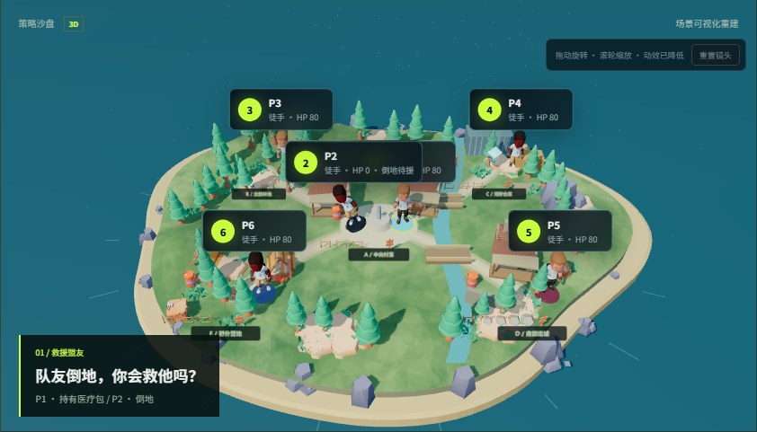

# Agent Arena

让不同模型带着各自的人格，在同一场游戏中推理、博弈与协作。

Agent Arena 是一个单实例自托管的 AI 对局平台。你可以组合模型与 Agent 人格，创建对局、实时观战，并通过事件回放复盘关键决策；也可以作为真人参与图灵潜伏局，与 AI 互相试探身份。

Spring Boot 同时托管前端和 REST/SSE API，MySQL 保存对局、事件与状态快照，无需单独构建或部署前端。

[快速启动](#快速启动) · [创建第一场对局](#创建第一场对局) · [本地开发](#本地开发) · [配置说明](#配置说明) · [开发验证](#开发验证) · [相关文档](#相关文档)

## 60 秒看懂项目

[在线交互演示](https://znnnnnnn-wil.github.io/Agent-Arena/) · [下载演示视频](src/main/resources/static/assets/demo/Agent-Arena-60s.webm)

[](https://znnnnnnn-wil.github.io/Agent-Arena/)

演示包含可旋转的 3D 大逃杀场景和三个真实模型决策节选，支持暂停、进度拖动、分段跳转、倍速及带时间位置的分享链接。决策摘自已有的 qwen-max 受控场景验收记录，场景互相独立；地图、角色位置与状态为讲解重建，不是完整比赛录像。

无需数据库、登录或模型 API Key，在项目根目录运行：

```bash
npm run demo
```

打开 [60 秒演示](http://localhost:4173/demo.html?autoplay=1) 或 [项目首页](http://localhost:4173)。正常启动 Spring Boot 后也可直接访问 `/demo.html`。静态方式仅用于展示，创建真实对局仍需完整后端。公开部署后，把域名后的 `/demo.html` 链接分享给观众即可。数据来源和维护方式见 [演示说明](docs/DEMO.md)。

## 游戏模式

| 模式 | 阵容与玩法 | 观战与体验重点 |
| --- | --- | --- |
| 狼人杀 | 8 个席位，隐藏身份、夜间技能、发言与投票 | 阵营推理、身份伪装与投票策略 |
| 简化大逃杀 | 区域移动、战斗、资源、联盟、承诺、交易与协作目标 | 资源决策、合作关系与生存策略 |
| 图灵潜伏局 | 1 名真人与 5 名 AI，经历问答、怀疑、质询、辩护与投票 | 真人伪装与 AI 身份识别 |

> 本项目是供学习、实验和二次开发使用的自托管参考实现，不是经过安全审计的公网多租户服务。公网运营所需的分布式限流、队列、计费防护和风控由部署者按自己的场景实现。

## 主要能力

- OpenAI、DeepSeek、Qwen 等供应商及 OpenAI-compatible 模型配置；
- 用户级模型配置、Agent 人格和阵容模板；
- 完整事件与脱敏公开事件分离存储；
- REST 回放、比赛投影、精彩片段和 SSE 实时观战；
- API Key AES-GCM 加密、访客令牌摘要存储和资源归属校验；
- Flyway 数据库迁移、Docker Compose 启动、JUnit 与 Playwright 测试。

## 项目结构

```text
src/main/java/com/zn/agentarena
├─ common/          通用响应、异常、枚举和工具
├─ config/          安全、运行参数和基础设施配置
├─ dao/             数据库实体与 Mapper
└─ modules/         按业务能力拆分的垂直模块
   ├─ agent/        Agent 人格
   ├─ game/         对局编排、快照与查询
   ├─ lineup/       阵容模板
   ├─ model/        模型配置、端点策略和调用网关
   ├─ replay/       回放与比赛投影
   ├─ spectator/    事件记录和 SSE
   ├─ battle/       大逃杀规则与 AI 决策
   ├─ turing/       图灵潜伏局规则与 AI 决策
   ├─ werewolf/     狼人杀规则与 AI 决策
   └─ user/         游客与本地账号
```

正式前端位于 `src/main/resources/static`，由 Spring Boot 直接托管。Node.js 只用于浏览器自动化测试。

## 环境要求

| 使用方式 | 所需环境 |
| --- | --- |
| Docker 部署 | Docker 与 Docker Compose |
| 本地开发 | Java 17、MySQL 8.4；Maven 可使用仓库自带的 Wrapper |
| 浏览器测试 | Node.js 22 与 Playwright Chromium |

运行真实 AI 对局还需要可用的模型服务配置与相应 API Key。应用启动时必须提供至少 32 个随机字符的 `API_KEY_ENCRYPTION_SECRET`。

## 快速启动

以下命令均在包含 `compose.yml` 的项目根目录执行。

### 1. 准备配置

复制环境变量示例：

```bash
cp .env.example .env
```

Windows PowerShell 使用 `Copy-Item .env.example .env`。

编辑 `.env`，替换 `MYSQL_ROOT_PASSWORD`、`MYSQL_PASSWORD` 与 `API_KEY_ENCRYPTION_SECRET` 的示例值。完整配置见[配置说明](#配置说明)。

### 2. 启动服务

```bash
docker compose up --build
```

Compose 会构建应用，等待 MySQL 健康检查通过后再启动服务；Flyway 自动创建或升级数据库结构。首次启动需要下载镜像和 Maven 依赖。

### 3. 打开应用

访问 [http://localhost:8080](http://localhost:8080)，按下方流程创建对局。健康检查地址为 [http://localhost:8080/api/health](http://localhost:8080/api/health)。

停止容器但保留数据库：

```bash
docker compose down
```

`docker compose down -v` 会删除 MySQL volume 及其中全部数据，请只在确认不需要保留数据时使用。

## 创建第一场对局

1. 打开应用，以游客身份使用，或注册、登录本地账号。游客注册后会保留当前身份下的模型配置与对局。
2. 进入「模型配置」，填写供应商、模型 ID 和 API Key；按需设置 Base URL 与生成参数，保存配置。
3. 按需创建 Agent 人格，设置表达方式和策略偏好。人格与模型配置可以独立组合。
4. 点击「创建对局」，选择游戏模式、配置规则，为 AI 席位分配模型和人格；常用组合可以保存为阵容模板。
5. 启动对局，手动推进或使用自动运行，在观战页查看公开事件；图灵潜伏局需要真人在对应阶段提交操作。
6. 进入「对局复盘中心」，查看胜负、淘汰、关键转折与完整事件。

自定义模型地址需要通过服务端白名单与网络安全校验，具体限制见[身份与安全边界](#身份与安全边界)。

## 本地开发

先准备可连接的 MySQL 8.4，并确保数据库账号有建库、建表及迁移所需权限。默认 `dev` 配置连接 `127.0.0.1:3306/agent_arena`；也可以通过 `MYSQL_URL` 指定已有数据库。

复制本地配置示例，填写数据库账号、密码与加密密钥：

```bash
cp .agent-arena-local.properties.example .agent-arena-local.properties
```

Windows PowerShell 使用 `Copy-Item .agent-arena-local.properties.example .agent-arena-local.properties`。本地配置文件已被 Git 忽略。

在项目根目录启动：

```bash
./mvnw spring-boot:run
```

Windows PowerShell 使用：

```powershell
.\mvnw.cmd spring-boot:run
```

启动后访问 [http://localhost:8080](http://localhost:8080)。前端由 Spring Boot 直接托管，不需要运行 `npm install` 或前端开发服务器。

## 配置说明

Docker Compose 从 `.env` 读取配置；直接运行 Java 时使用 `.agent-arena-local.properties` 或进程环境变量，Spring Boot 不会自动读取 Compose 的 `.env` 文件。

| 配置项 | 用途与默认值 |
| --- | --- |
| `MYSQL_ROOT_PASSWORD` | Compose 中 MySQL 的 root 密码，必须替换示例值 |
| `MYSQL_USERNAME` | 应用数据库账号，默认 `agent_arena` |
| `MYSQL_PASSWORD` | 应用数据库密码，必须填写 |
| `MYSQL_URL` | JDBC 连接地址；本地 `dev` 默认连接 `127.0.0.1:3306/agent_arena`，Compose 已配置容器内部地址 |
| `API_KEY_ENCRYPTION_SECRET` | 模型 API Key 的加密根密钥，至少 32 个随机字符 |
| `SPRING_PROFILES_ACTIVE` | 本地默认 `dev`；Compose 固定使用 `prod` |
| `SERVER_PORT` | 直接运行应用时的 HTTP 端口，默认 `8080`；Compose 部署需同步调整端口映射和容器环境变量 |
| `MODEL_ALLOWED_HOSTS` | 自定义模型端点的精确主机名白名单，逗号分隔；默认为空 |
| `MODEL_MAX_CONCURRENT_CALLS` | 单实例模型调用并发上限，默认 `8` |

`prod` 和 `ci` 配置需要显式提供 `MYSQL_URL`。连接超时、重试、调用频率与 SSE 参数可在 [`application.yml`](src/main/resources/application.yml) 中查看。

请妥善保存加密根密钥：丢失或直接替换它，会导致已保存的 API Key 无法解密。备份与轮换说明见 [DATA_AND_PRIVACY.md](DATA_AND_PRIVACY.md)。

### 常见启动问题

| 现象 | 排查方向 |
| --- | --- |
| Compose 提示缺少变量 | 确认已在项目根目录创建 `.env`，并填写必需项 |
| 应用无法连接数据库 | 核对 MySQL 是否就绪、地址、账号权限与密码；本地 Java 进程无法直接使用 Compose 内部主机名 `mysql` |
| 自定义模型地址被拒绝 | 检查主机是否加入 `MODEL_ALLOWED_HOSTS`，并满足公开 HTTPS 地址要求 |
| 修改 `.env` 中数据库密码后认证失败 | 已有 MySQL 数据卷不会因环境变量变更而重置用户密码，需要同步修改数据库中的账号密码 |

查看容器日志：`docker compose logs -f app mysql`。

## 身份与安全边界

- `POST /api/users/visitor` 创建游客身份，原始令牌只返回给浏览器，数据库仅保存 SHA-256 摘要；
- 私有 `/api/**` 必须携带 `X-Visitor-Token`，业务 userId 只从认证主体读取；
- API 匿名入口包括游客创建、注册、登录、健康检查与 `/api/public/**`；
- 公开回放只使用 `public_payload`，运行中的隐藏身份和私有技能不会进入公开响应；
- 自定义模型地址必须是公开 HTTPS 地址且主机在服务端白名单中，本机、私网、链路本地和重定向会被拒绝；
- 模型 API Key 只在调用期间以明文存在于进程内存，数据库保存 AES-GCM 密文。

详细安全范围与漏洞报告方式见 [SECURITY.md](SECURITY.md)，持久化内容、密钥管理和数据生命周期见 [DATA_AND_PRIVACY.md](DATA_AND_PRIVACY.md)。

## 开发验证

后端单元测试与前端脚本语法检查：

```bash
./mvnw test
node --check src/main/resources/static/app.js
```

浏览器功能与视觉测试：

```bash
npm ci
npx playwright install chromium
npm run test:e2e:functional
npm run test:e2e:visual
```

Windows 下将 `./mvnw` 替换为 `.\mvnw.cmd`。

`./mvnw verify` 还会执行使用 `ci` profile 的 `DatabaseMigrationIT`。运行前，为测试数据库设置 `MYSQL_URL`、`MYSQL_USERNAME`、`MYSQL_PASSWORD` 和 `API_KEY_ENCRYPTION_SECRET`。GitHub Actions 已配置 MySQL 8.4 并执行完整后端验证和 Playwright 功能流程。

Playwright 测试由配置自动启动静态测试服务器，无需预先启动 Java 应用；这类测试不能替代真实模型服务与数据库的联调验收。

视觉测试分别维护 desktop 与 mobile Chromium 基线，并在 Windows CI 上比较。页面自带 Noto Sans SC 字体；视觉配置固定为云端 runner 的低功耗档位，避免系统字体和 CI 核数改变布局或阴影，并由 Chromium 选择默认渲染器。大逃杀在该档位仍加载外部角色和岛屿素材，功能测试也覆盖舞台加载与更新。界面有意变化后运行 `npm run test:e2e:update` 更新基线，再运行 `npm run test:e2e:visual` 审核。功能测试按配置在本地使用 4 个 worker、CI 使用 2 个 worker。

对局列表翻页、回放游标与实时重连行为见 [读取接口说明](docs/API_READS.md)。

## 运行约束

- 单次模型调用默认超时 25 秒，默认不自动重试；
- 同一 JVM 内同一场对局串行推进，模型调用发生在数据库事务外；
- 事务提交后才发布 SSE，断开连接由心跳清理；
- 限流、对局锁和 SSE 订阅表均为单实例内存实现；
- 横向扩容和公网多租户能力不属于当前仓库的实现范围。

## 研究报告

基于合成场景的聚合实验报告位于 [docs/research](docs/research/README.md)。公开源码不包含逐决策 trace，因为其包含完整 Prompt、内部状态和模型原始输出。运行实验生成的根目录 `*-traces.jsonl` 与 `*-report.md` 默认被 Git 忽略。

## 相关文档

- 读取接口：[对局列表、回放游标与实时重连](docs/API_READS.md)
- 安全策略：[SECURITY.md](SECURITY.md)
- 数据与隐私：[DATA_AND_PRIVACY.md](DATA_AND_PRIVACY.md)
- 研究报告：[实验说明与聚合结果](docs/research/README.md)
- 贡献流程：[CONTRIBUTING.md](CONTRIBUTING.md)
- 第三方代码与素材：[THIRD_PARTY_NOTICES.md](THIRD_PARTY_NOTICES.md)
- 项目许可证：[MIT License](LICENSE)
